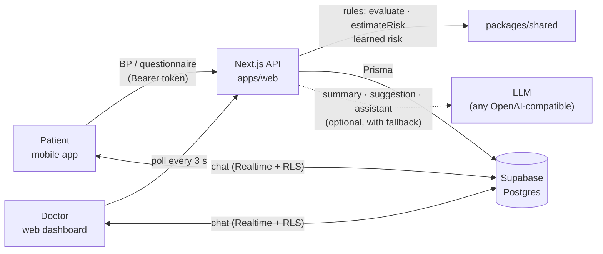

# SafeMaman

**Follow-up of hypertension during pregnancy, between two consultations.**
A mobile app for the pregnant patient, a web dashboard for her doctor, and one explainable rules engine in between.

> **The app assists, the doctor decides.** It never diagnoses, prescribes or changes a treatment, and a low risk estimate never tells a patient not to seek help.

Built for **Hackathon SolveX 3.0 · Problem 2**. The interface is in French.

---

## Contents

1. [Quick start](#quick-start)
2. [The problem](#the-problem)
3. [What it does](#what-it-does)
4. [How it works](#how-it-works)
5. [Medical rules](#medical-rules)
6. [Artificial intelligence](#artificial-intelligence)
7. [Tech stack and repository layout](#tech-stack-and-repository-layout)
8. [Installation](#installation)
9. [Run the web dashboard and the API](#run-the-web-dashboard-and-the-api)
10. [Run the mobile app](#run-the-mobile-app)
11. [Demo accounts](#demo-accounts)
12. [Testing](#testing)
13. [Demo scenario (2 minutes)](#demo-scenario-2-minutes)
14. [API reference](#api-reference)
15. [Troubleshooting](#troubleshooting)
16. [Team and Git workflow](#team-and-git-workflow)
17. [Security and privacy](#security-and-privacy)
18. [Roadmap](#roadmap)

---

## Quick start

For a team member who already has the `.env` files (see [Installation](#installation) otherwise):

```bash
pnpm install
pnpm --filter web dev                 # terminal 1: dashboard + API → http://localhost:3000
pnpm --filter mobile start -c         # terminal 2: mobile app → scan the QR code with Expo Go
```

Log in on the dashboard as **`docteur@demo.dz` / `Demo1234!`**, and on the phone as **`amina@demo.dz` / `Demo1234!`**.

---

## The problem

Gestational hypertension and pre-eclampsia can turn dangerous within hours, often between two prenatal visits. Patients measure their blood pressure at home but have no simple way to know when a reading or a symptom is urgent, and doctors have no view of what happens between visits.

SafeMaman closes that gap:

- the **patient** records her blood pressure and a short daily questionnaire on her phone, and gets a clear answer — including *"go to the maternity emergency room or call 14 now"* when needed;
- the **doctor** sees all her patients sorted by urgency, with the reason, within seconds, and acts (chat, note).

## What it does

### Mobile app (Expo) — for the patient

| Screen | What it does |
| --- | --- |
| Sign up / log in | Email + password (Supabase Auth) |
| Profile + consent | Name, birth date (age computed), due date or last period (pregnancy week computed daily), medical history (first pregnancy, twins, chronic hypertension, previous pre-eclampsia, diabetes, kidney / autoimmune disease, family history, IVF), height, weight, treatments |
| Initial risk | Low / moderate / high **with every contributing factor**, "estimation indicative, pas un diagnostic" |
| Add my doctor | One-time 6-character code given by the doctor, then "pending" until the doctor accepts |
| Add blood pressure | Large +/− steppers with guidance (rest 5 min, seated, arm at heart level) |
| Daily questionnaire | 6 danger signs and 4 watch signs, yes / no |
| Result screen | Status (icon + colour + word) and message; full-screen emergency with a `tel:14` button, or a re-measure countdown for a severe reading |
| History | Blood pressure chart with the 140/90 and 160/110 lines, past questionnaires |
| Chat | Live chat with her doctor ("Le chat n'est pas pour les urgences.") |
| Reminders | Local notifications for measurements and the questionnaire |
| Information assistant | General questions about hypertension in pregnancy (API ready; screen in progress) |

**Light doctor mode** in the same app: patient list sorted by urgency, patient summary, invite-code generator, link requests.

### Web dashboard (Next.js) — for the doctor only

| Page | What it does |
| --- | --- |
| Login | Doctor accounts only (patients are refused and sent to the app) |
| **Patientes** (triage) | All linked patients sorted from most urgent to most stable, filters by level with counts, search, pending-request banner. Each row: status (icon + colour + word), name, pregnancy week, last reading and time, risk, reason. Refreshes every 3 s. |
| **Patient file** | Why this level (every rule that fired), BP chart with threshold lines (unconfirmed readings shown hollow), full reading history, every questionnaire answer, alerts, risk factors and risk timeline, **learned risk (experimental)**, profile, **AI summary** (stored, or regenerated on demand), doctor notes, live chat with an **AI message suggestion** the doctor edits before sending |
| **Alertes** | Open / acknowledged / closed alerts; acknowledge, close |
| **Codes et demandes** | Generate one-time invite codes (24 h), accept or refuse link requests (only the name and date are visible before acceptance) |

## How it works



1. The patient records a reading or a questionnaire on her phone.
2. The API runs the **shared rules** (`packages/shared`): it confirms or expires severe readings, estimates the risk, decides the level and opens or updates alerts.
3. The phone shows the result (emergency, re-measure, or status).
4. The doctor's dashboard shows the change within 3 seconds; the doctor opens the file, sees **why**, and acts (chat, note).

**One engine:** risk and alert rules exist only in `packages/shared/src/domain/` as pure, tested functions. The apps only display what the API returns, and **no AI ever decides a level, an alert or a risk**.

## Medical rules

All values are initial values from common obstetric guidelines and **must be validated by a doctor or midwife**. They live in one file: `packages/shared/src/domain/config.ts`.

**Blood pressure** ("≥" means systolic ≥ OR diastolic ≥):

| Range | Threshold |
| --- | --- |
| Hypertensive | ≥ 140/90 |
| Severe | ≥ 160/110, must be confirmed by a second reading within 60 min (re-measure after 15 min, 10 s in demo mode) |

**Levels** (detection order is fixed; the most severe wins):

| Level | Trigger | Patient sees |
| --- | --- | --- |
| Emergency | a danger sign answered yes (severe headache, vision problems, upper abdominal pain, sudden swelling of face or hands, breathing difficulty, reduced fetal movement) | Urgent — go to the maternity emergency room or call 14 |
| Severe | confirmed reading ≥ 160/110 | Urgent — same message |
| High | 2 of the last 3 valid readings ≥ 140/90 | Attention |
| Watch | systolic rising over 14 days, risk raised, or a watch sign (mild headache, leg swelling, nausea, unusual fatigue) | À surveiller |
| Silent | no reading for 2 × the expected interval | À suivre |
| OK | none of the above | Bon |

An unconfirmed severe reading is never hidden: the doctor sees it ("Sévère non confirmée"), right after Emergency and Severe in the triage order.

**Rule-based risk** (explainable): high-weight factors (previous pre-eclampsia, chronic hypertension, pre-existing diabetes, kidney disease, autoimmune disease, multiple pregnancy) and moderate ones (first pregnancy, age ≥ 40, BMI ≥ 35, family history of pre-eclampsia, IVF). HIGH if ≥ 1 high-weight or ≥ 2 moderate factors, MODERATE if 1 moderate, LOW otherwise; raised by hypertensive readings, a rising trend or recent watch signs; never lowered below the initial category. Every estimate is stored, so the doctor sees the risk timeline.

## Artificial intelligence

Two kinds of AI, both **doctor-facing aids that never change levels, alerts or the rule-based risk**.

### 1. Learned risk — trained on 7 million real births (experimental)

A probability of developing gestational hypertension or eclampsia, shown in the patient file next to the rule-based risk.

- **Data:** CDC / NCHS natality public-use files — every US birth certificate, public domain. **Trained on 2022 (3.56 M births), tested on 2023 (3.49 M births it never saw).**
- **Inputs:** only what the app's profile collects — age band, BMI band, first pregnancy, twins, IVF, pre-existing diabetes, gestational diabetes.
- **Model:** explainable logistic regression; the doctor sees each factor's multiplier (BMI ≥ 35 ×3.5, pre-existing diabetes ×2.4, twins ×2.0, first pregnancy ×1.7…).
- **Results on 2023:** ROC-AUC **0.65** (current profile rules: 0.60); calibrated (predicted and observed risk match in every tenth). A GPU-trained XGBoost model (RTX 4050) reached 0.66 but was kept out because a doctor cannot read it.
- **Limits:** not applicable with chronic hypertension (the data cannot describe it), US population, moderate accuracy expected from profile factors alone.
- Runs in plain TypeScript (`packages/shared/src/ml/`), checked against Python on 500 reference cases.

Full model card, data, metrics and how to retrain: **[ml/README.md](ml/README.md)**.

### 2. AI texts — summary, message suggestion, assistant

| Feature | Who | What |
| --- | --- | --- |
| Summary on demand | Doctor | One French paragraph from the computed facts; label "Synthèse générée par IA — à vérifier" |
| Message suggestion | Doctor | A short message to the patient, put in the chat box; **the doctor edits and sends it himself** |
| Information assistant | Patient | General information only; refuses diagnosis and treatment advice |

- **Any OpenAI-compatible provider** (Ollama locally, Groq, OpenAI, Mistral, Gemini…), set with three variables. Plain `fetch`, no SDK.
- **Works without any key:** with no key, a timeout (10 s) or an error, each feature returns a built-in text built from the same facts, labelled honestly ("Synthèse automatique (IA indisponible)"). Stored summaries are returned without any call: **the demo never depends on a live AI**.
- **The model only receives computed facts** (readings, trend, reasons, symptoms, risk factors) — never the patient's name or her own words.
- **Safety enforced by code, not trusted to the model:** for any symptom or high reading, the assistant's answer always contains *"Si vous avez ce symptôme, allez aux urgences de la maternité ou appelez le 14"*; an urgent patient's suggested message always says to go now.

## Tech stack and repository layout

| Part | Choice |
| --- | --- |
| Monorepo | pnpm workspaces |
| Web + API | Next.js 15 (App Router), TypeScript strict, TanStack Query |
| Mobile | React Native + Expo (Expo Router), TanStack Query |
| Database | Supabase Postgres + Prisma (migrations in `apps/web`) |
| Auth | Supabase Auth on both apps; the API verifies the access token server-side |
| Chat | Supabase Realtime on the `Message` table, protected by Row Level Security |
| Validation | Zod schemas shared by the API and both apps |
| ML | Python 3.12, scikit-learn, XGBoost (CUDA), pandas — in `ml/` only |
| Tests | Vitest |

```
apps/
  web/              Next.js: doctor dashboard + the API used by both apps
    prisma/           schema, migrations, sql/rls.sql, seed (demo data)
    src/server/       API services: auth, pipeline (rules on DB data), patient, doctor, linking
    src/lib/llm/      AI texts: provider-neutral client, facts, prompts, fallbacks, safety
    src/app/api/      API routes
    src/app/d/        dashboard pages
  mobile/           Expo app: patient space + light doctor space
packages/
  shared/           rules (evaluate, estimateRisk, triage…), Zod schemas, learned-risk scorer, tests
ml/                 learned risk: CDC data extraction, training (GPU), model card, reports
  archive/          first exploratory model (not used)
docs/
  MOBILE-GUIDE.md   every mobile screen → its API route → its shared schema
idea.md             the product: what we build, for whom, the expected demo
```

## Installation

### Prerequisites

- **Node.js 20+** and **pnpm 9.15** (`npm install -g pnpm@9.15.0`)
- **Expo Go** on an Android or iOS phone (for the mobile app)
- A **Supabase** project (database, auth, realtime) — already set up for the team
- *Optional:* **Ollama** for free, local AI texts; *optional:* Python 3.12 + an NVIDIA GPU to retrain the model in `ml/`

### 1. Install

```bash
git clone https://github.com/RamyRxr/VOLTEX.git
cd VOLTEX
pnpm install
```

### 2. Environment files

Secrets are **never committed**: every `.env` file is ignored by Git. Copy the templates and fill them; team members get the values privately from the project owner.

```bash
cp apps/web/.env.example apps/web/.env
cp apps/mobile/.env.example apps/mobile/.env
```

**`apps/web/.env`** (server only):

| Variable | Value |
| --- | --- |
| `DATABASE_URL` | Supabase → **Connect** → transaction pooler (port 6543), add `?pgbouncer=true` |
| `DIRECT_URL` | Supabase → **Connect** → session pooler or direct connection (port 5432), used by migrations |
| `NEXT_PUBLIC_SUPABASE_URL` | Supabase → Project Settings → **API Keys** → project URL |
| `NEXT_PUBLIC_SUPABASE_ANON_KEY` | Supabase → Project Settings → **API Keys** → publishable / anon key |
| `SUPABASE_SERVICE_ROLE_KEY` | Supabase → Project Settings → **API Keys** → secret / service-role key (**server only**) |
| `LLM_BASE_URL` | any OpenAI-compatible API, e.g. `http://localhost:11434/v1` (Ollama), `https://api.groq.com/openai/v1` |
| `LLM_API_KEY` | the provider key; **leave empty to use the built-in texts**; any value (e.g. `ollama`) for Ollama |
| `LLM_MODEL` | the model name, e.g. `qwen2.5:7b` (Ollama), `llama-3.3-70b-versatile` (Groq) |
| `CRON_SECRET` | any random string of 32+ characters (for `/api/jobs/silence`) |
| `DEMO_MODE` | `true` shortens the severe re-measure delay to 10 s and shows a banner |
| `ALLOW_DEMO_SEED` | `true` only on a demo project, to allow the seed to run |

**`apps/mobile/.env`** (public values only — never the secret key or database URLs):

| Variable | Value |
| --- | --- |
| `EXPO_PUBLIC_API_URL` | `http://<IP of the PC running the API>:3000` — see [Run the mobile app](#run-the-mobile-app) |
| `EXPO_PUBLIC_SUPABASE_URL` | same project URL as above |
| `EXPO_PUBLIC_SUPABASE_ANON_KEY` | same publishable / anon key as above |
| `EXPO_PUBLIC_DEMO_MODE` | `true` |

### 3. Database (project owner only, once)

The team database is already created and seeded. To set up a **new** Supabase project:

```bash
pnpm --filter web db:deploy   # create the tables (Prisma migrations)
pnpm --filter web db:rls      # Row Level Security on every table + chat policies + Realtime on Message
pnpm --filter web db:seed     # 9 demo doctors, 57 demo patients (needs ALLOW_DEMO_SEED=true)
```

For testing, turn off email confirmation: Supabase → **Authentication → Sign In / Providers → Email → Confirm email** off (otherwise new accounts must click the link sent by email before logging in).

> Never run migrations or the seed against a production project. The seed refuses to run without `ALLOW_DEMO_SEED=true` or with `NODE_ENV=production`.

### 4. AI texts with a free local model (optional)

Without this step the AI buttons use their built-in texts. To use a real model, free and private (patient facts never leave the PC):

```bash
# install Ollama from https://ollama.com, then:
ollama pull qwen2.5:7b
```

In `apps/web/.env`: `LLM_BASE_URL=http://localhost:11434/v1`, `LLM_API_KEY=ollama`, `LLM_MODEL=qwen2.5:7b`, then restart the dev server. A deployed API cannot reach a laptop's Ollama: use a cloud provider there (e.g. Groq's free tier).

## Run the web dashboard and the API

```bash
pnpm --filter web dev
```

- The terminal must print `Local: http://localhost:3000` (if it says **3001**, an old server still holds port 3000 — see [Troubleshooting](#troubleshooting)).
- Open **http://localhost:3000** and log in as a doctor (`docteur@demo.dz` / `Demo1234!`).
- The same server is the **API** used by the mobile app: keep it running while you use the app.
- Health check: http://localhost:3000/api/me must answer `{"error":"UNAUTHORIZED","message":"Connexion requise"}` (correct: the browser is not logged in).

## Run the mobile app

You need **two terminals**: the API (above) and Expo.

1. Find the IPv4 address of the PC running the API:
   - Windows: `ipconfig` → "Wi-Fi" → IPv4 Address
   - macOS: `ipconfig getifaddr en0`
2. Put it in `apps/mobile/.env`: `EXPO_PUBLIC_API_URL=http://<that IP>:3000` (`http`, no `localhost`, no trailing `/`).
3. Start Expo (`-c` clears its cache so the new `.env` is used):
   ```bash
   pnpm --filter mobile start -c
   ```
4. Scan the QR code with **Expo Go**. The phone and the PC must be on the **same network** (same Wi-Fi, or the PC connected to the phone's hotspot).
5. Check from the phone's browser: `http://<that IP>:3000/api/me` must show `{"error":"UNAUTHORIZED",…}`. If it does not load, see [Troubleshooting](#troubleshooting).

You can log in with a demo account or create a new one.

## Demo accounts

All fictional. Password for every account: **`Demo1234!`**

| Account | Role | Situation |
| --- | --- | --- |
| `docteur@demo.dz` | Doctor | Dr Karima Benali: 16 linked patients + 1 pending request |
| `dr.haddad@demo.dz`, `dr.mebarki@demo.dz`, `dr.kherbache@demo.dz`, `dr.boukhalfa@demo.dz`, `dr.taleb@demo.dz`, `dr.guerroudj@demo.dz`, `dr.belaid@demo.dz`, `dr.ouali@demo.dz` | Doctors | 5 patients each, mixed levels |
| `amina@demo.dz` | Patient | 29 y, 31 weeks, first pregnancy, stable — **the live demo patient** |
| `sarah@demo.dz` | Patient | previous pre-eclampsia + chronic hypertension → high risk |
| `lina@demo.dz` | Patient | systolic rising over 14 days → Watch, risk raised |
| `meriem@demo.dz` | Patient | twins, 2 of the last 3 readings ≥ 140/90 → High |
| `yasmine@demo.dz` | Patient | no reading for 3 days → Silent |
| `nour@demo.dz` | Patient | one 165/112 never re-measured → "Sévère non confirmée" |
| `khadija@demo.dz` | Patient | link request still pending |
| `patiente01@demo.dz` … `patiente40@demo.dz` | Patients | the other doctors' patients |

Every level comes from the rules applied to the seeded readings, never from a hardcoded value. Re-run `pnpm --filter web db:seed` to reset the demo (several minutes).

## Testing

### Automated checks

```bash
pnpm -r typecheck            # every package
pnpm -r lint
pnpm --filter shared test    # rules, schemas, learned risk vs Python (68 tests)
pnpm --filter web test       # dashboard helpers, AI client, fallbacks and safety (28 tests)
```

### Manual end-to-end test

With the API and Expo running:

1. **Dashboard:** log in as `docteur@demo.dz`. Nour is first ("Sévère non confirmée"), then Meriem (Élevée), Lina (À surveiller), Yasmine (Sans nouvelles), then the stable patients.
2. **Phone:** log in as `amina@demo.dz`, add a reading of **165/112** → the app asks to re-measure (10 s in demo mode).
3. Add **163/111** → full-screen emergency with the `tel:14` button.
4. **Dashboard:** within 3 s, **Amina moves to the top as "Sévère"** and a new alert appears in **Alertes**.
5. Open Amina's file → chart, readings, alert and "why" are there; the **learned risk** card shows her probability and factors. Click **Générer une nouvelle synthèse** and **Suggérer un message**.
6. Send a chat message → it appears on the phone instantly; reply from the phone → it appears on the dashboard.
7. **Phone:** fill the questionnaire with "Troubles de la vue = oui" → emergency; the dashboard shows an "Urgence" alert.
8. **Linking:** create a new patient account in the app, fill the profile, then on the dashboard **Codes et demandes → Générer un code**, enter it in the app ("Ajouter mon médecin"), and **Accepter** → she appears in the patient list.
9. **Access rules:** log in as `dr.haddad@demo.dz` → only his 5 patients are visible, none of Dr Benali's.

Reset afterwards with `pnpm --filter web db:seed`. To inspect the data: `pnpm --filter web db:studio`.

## Demo scenario (2 minutes)

1. **Dashboard on screen** (`docteur@demo.dz`): patients sorted by urgency, each with an icon, a colour, a word and the reason.
2. **Phone** (Amina): 165/112 → "Reposez-vous et mesurez à nouveau" → 163/111 → **"Allez aux urgences de la maternité ou appelez le 14"**.
3. **Dashboard:** Amina jumps to the top as **Sévère** within 3 s; open her file: why, chart, alert.
4. **Doctor acts:** "Suggérer un message" → edit → send; it arrives on the phone instantly.
5. **The AI story:** the learned-risk card — trained on 7 million real births, explainable, never deciding alone. *The app assists, the doctor decides.*

## API reference

All routes answer JSON; errors are `{ "error": CODE, "message": "French text" }`. Every request needs `Authorization: Bearer <Supabase access token>`. Request and response shapes are Zod schemas in `packages/shared/src/schemas/`.

| Method | Route | Who | Purpose |
| --- | --- | --- | --- |
| GET | `/api/me` | both | profile, role, pregnancy week (404 `NO_PROFILE` = profile to fill) |
| POST | `/api/patient/profile` | patient | create / update the profile with consent → `{ risk }` |
| GET | `/api/patient/risk` | patient | current risk with factors and reasons |
| POST / GET | `/api/patient/link` | patient | submit a doctor's code / link status |
| POST / GET | `/api/patient/sessions` | patient | new reading → `{ session, evaluation, risk }` / history |
| POST / GET | `/api/patient/questionnaires` | patient | daily questionnaire → `{ evaluation, risk }` / history |
| POST | `/api/patient/assistant` | patient | `{ question }` → `{ answer }`: general information only; a symptom or high reading always gets the emergency sentence |
| POST / GET | `/api/doctor/invites` | doctor | new 6-character code (24 h, single use) / active codes |
| GET | `/api/doctor/link-requests` | doctor | pending requests (name and date only) |
| PATCH | `/api/doctor/link-requests/:id` | doctor | `{ action: "ACCEPT" \| "REFUSE" }` |
| GET | `/api/doctor/patients` | doctor | triage list, sorted by urgency |
| GET / PATCH | `/api/doctor/patients/:id` | doctor | full patient file (incl. `learnedRisk`) / expected readings per day |
| POST | `/api/doctor/patients/:id/notes` | doctor | add a note or decision |
| POST | `/api/doctor/patients/:id/summary` | doctor | stored AI summary, or `{ "refresh": true }` for a new one → `{ text, generatedAt, fromCache, source }` |
| POST | `/api/doctor/patients/:id/draft-advice` | doctor | message suggestion the doctor edits and sends himself → `{ text, source }` |
| GET | `/api/doctor/alerts?status=` | doctor | alerts of linked patients |
| PATCH | `/api/doctor/alerts/:id` | doctor | `{ action: "ACK" \| "CLOSE" }` |
| GET / POST | `/api/jobs/silence` | cron | silence detection + expiry of pending severe readings (`CRON_SECRET`) |

The chat does not use the API: both apps read and write the `Message` table directly through Supabase (RLS allows only the patient and her accepted doctor). See [docs/MOBILE-GUIDE.md](docs/MOBILE-GUIDE.md).

## Troubleshooting

| Symptom | Cause | Fix |
| --- | --- | --- |
| App says **"Pas de connexion. Réessayez dans un instant."** after login | The app cannot reach the API | Check `EXPO_PUBLIC_API_URL` is the PC's current IP and the API is running, then `pnpm --filter mobile start -c` |
| `http://<IP>:3000/api/me` does not load on the phone | Phone and PC cannot talk | Same Wi-Fi (or the phone's hotspot); allow **Node.js** in Windows Firewall (Private and Public); some campus / event Wi-Fi blocks devices from each other → use a hotspot |
| The API starts on **3001** | An old server still holds port 3000 (Ctrl+C on Windows can leave Node running) | PowerShell: `Get-NetTCPConnection -LocalPort 3000 -State Listen \| ForEach-Object { Stop-Process -Id $_.OwningProcess -Force }`, then start again |
| `ENOENT … .next-dev … route.js` or `Expected clientReferenceManifest` | The dev build folder changed while the server was running | Stop the server (as above), delete `apps/web/.next-dev`, run `pnpm --filter web dev` again |
| New account cannot log in ("Email not confirmed") | Supabase email confirmation is on | Turn off **Confirm email** in Supabase, or click the link in the email |
| The summary says **"Synthèse automatique (IA indisponible)"** | No AI key, or the model is not running | Expected without a key; with Ollama, check `ollama serve` is running and the model is pulled |
| It worked yesterday, not today | Your IP changed (new network or hotspot) | `ipconfig`, update `EXPO_PUBLIC_API_URL`, `pnpm --filter mobile start -c` |

## Team and Git workflow

| Person | Part | Folder | Branch |
| --- | --- | --- | --- |
| Ramy ([@RamyRxr](https://github.com/RamyRxr)) | Doctor dashboard, API, database, rules, AI integration | `apps/web`, `packages/shared`, `ml/` | `ramy` |
| Yasser ([@yasser-zm](https://github.com/yasser-zm)) | Mobile app | `apps/mobile` | `yasser` |
| Seryne ([@serynemahfoufi](https://github.com/serynemahfoufi)) | AI / ML | `ml/`, `apps/web/src/lib/llm` | `seryne` |

`main` must always be demonstrable; everything reaches it through pull requests.

**Get the latest merged code** (before starting work, and after every merge):

```bash
git checkout main && git pull origin main
git checkout <your-branch> && git merge main && git push origin <your-branch>
pnpm install
```

If `pnpm-lock.yaml` conflicts: `git checkout --theirs pnpm-lock.yaml && pnpm install && git add pnpm-lock.yaml`.

Conventions: conventional commits (`feat(web): …`, `fix(mobile): …`), TypeScript strict, French UI text in `i18n/fr.ts` files, status always shown as icon + colour + word, and before any PR: typecheck, lint and tests pass.

## Security and privacy

- Every API query is scoped to the signed-in user: a patient sees only her own data; a doctor sees only patients with an **accepted** link to him. Nothing is shared before acceptance.
- Row Level Security is on for every table; only the chat table is open to the apps, and only to the two people of an accepted link.
- The service-role key and database URLs exist only in `apps/web` server code; the mobile app holds public values only. Never paste `.env` contents in a chat or a ticket; rotate a secret if it leaks.
- Invite codes: 6 characters without ambiguous letters, valid 24 h, single use; wrong, expired and used codes get the same message; attempts are rate-limited.
- Each patient's writes run under a database lock, so double taps and the background job cannot create inconsistent readings or duplicate alerts.
- The AI receives computed facts only (no name, no free text from the patient) and its prompts are never logged; with Ollama nothing leaves the PC.
- Logs never contain clinical values with names; all demo data is fictional.

## Roadmap

- **Next:** the assistant screen in the mobile app, the indicators page, deployment (Vercel + Supabase).
- **Later:** validate the thresholds and the learned risk with doctors and midwives; retrain the learned risk on local (Algerian) pregnancy data and add measured blood pressure as an input.
- **Not planned for the hackathon:** device import, SMS channel, Arabic RTL, server push notifications, multi-doctor teams.

---

**Medical disclaimer.** SafeMaman is a hackathon prototype. Its thresholds, danger signs, risk factors and learned model are initial values that must be validated by a doctor or midwife. It does not replace medical care: in case of a worrying symptom, go to the maternity emergency room or call **14**.
