# apps/mobile — SafeMaman app (Expo)

Owner: **Yasser** (branch `yasser`). Read the project spec (§4.1, §8, §11) and `../../idea.md` first.

One app, two spaces chosen by the role of the signed-in account:

| Space | Who | What |
| --- | --- | --- |
| **Patient** | pregnant woman | consent, medical profile, initial risk, add my doctor (code), measure BP (guided steppers), daily questionnaire, result screens (emergency / re-measure countdown), history chart, chat, reminders, info assistant |
| **Doctor** (light) | doctor | open alerts sorted by urgency, "mark as seen", notifications on new alerts, notification settings. The full patient file stays on the web dashboard. |

## Screenshots

Android emulator, Expo Go, demo mode, fictional demo patient `meriem@demo.dz`.

### Patient space

| | | | |
| --- | --- | --- | --- |
| 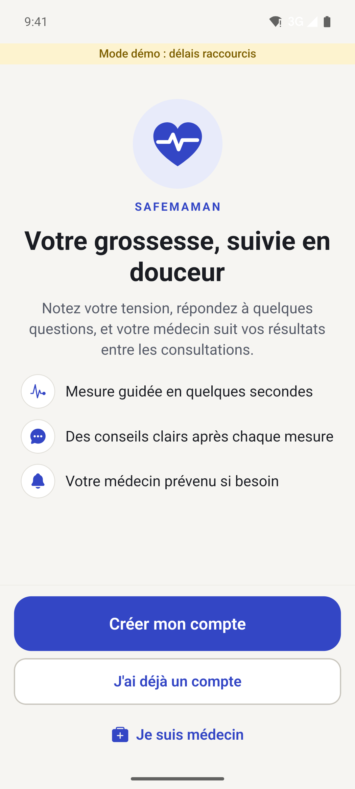 | 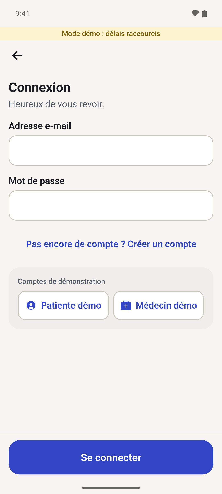 | 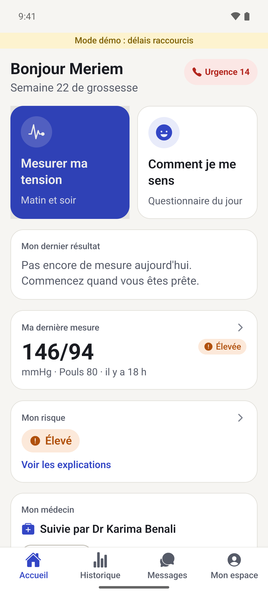 | 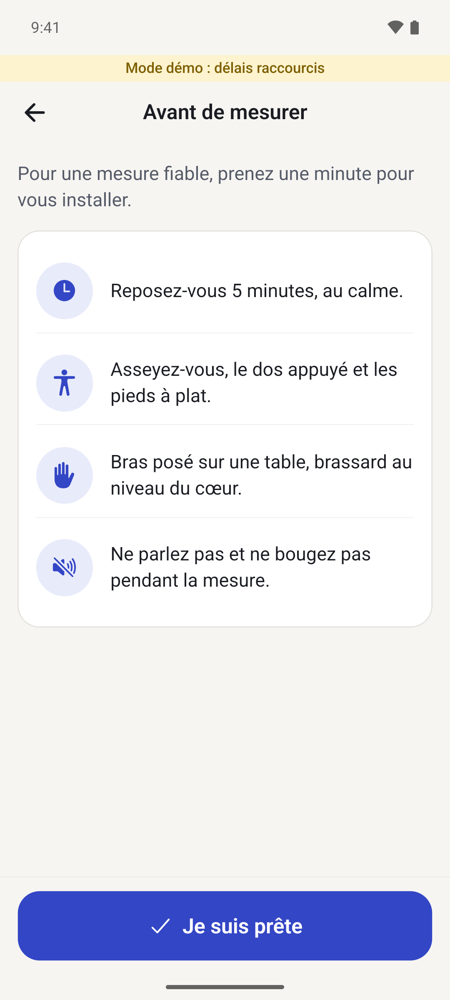 |
| Welcome | Login (demo accounts in one tap) | Home: last reading, risk, doctor | Guidance before measuring |
| 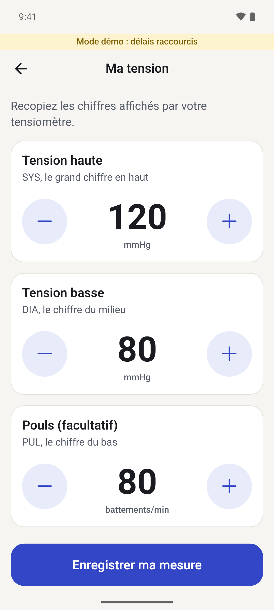 | 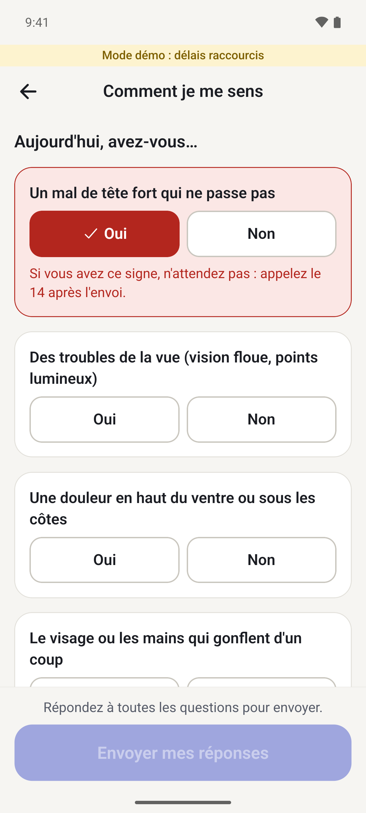 | 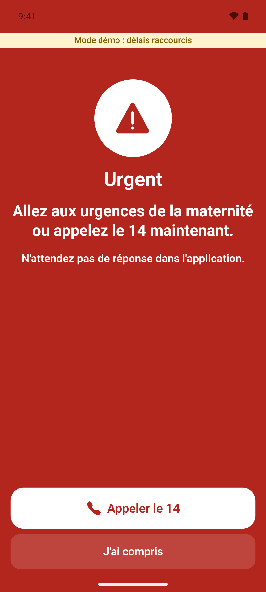 | 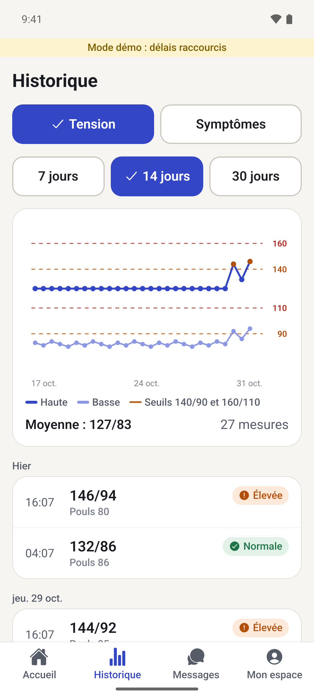 |
| Large +/− steppers | Daily questionnaire (danger sign highlighted) | Danger sign → call 14 now | History with 140/90 and 160/110 lines |
| 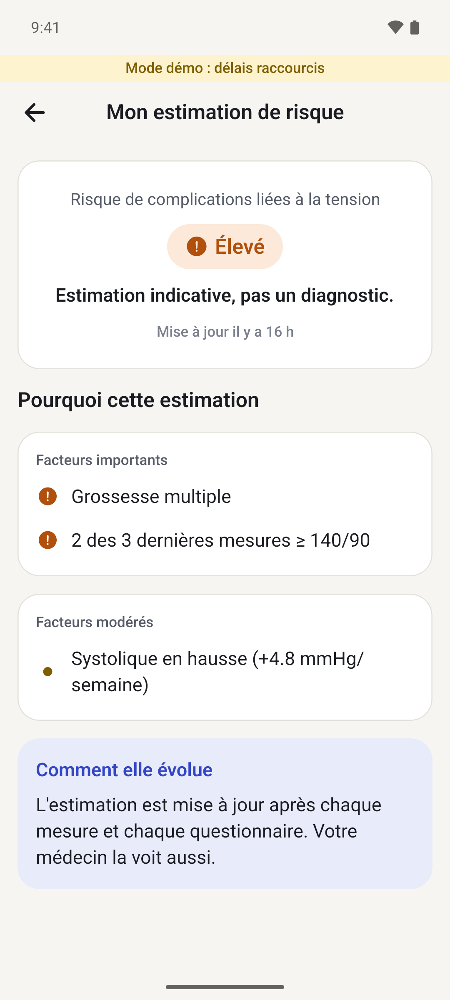 |  | 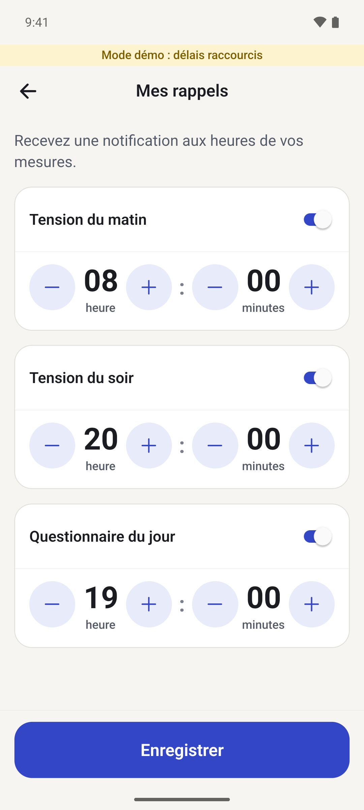 | 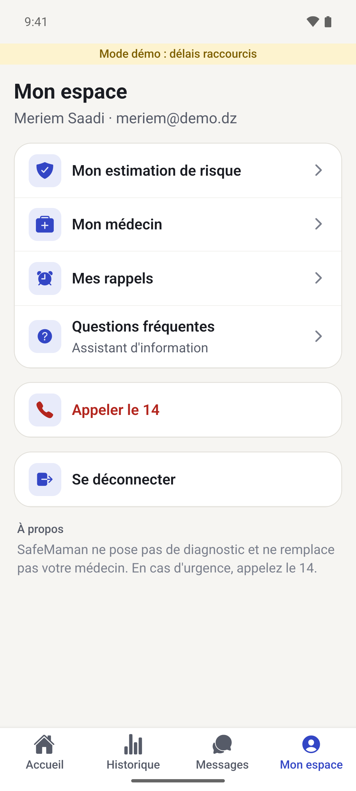 |
| Risk with its reasons | Chat with the doctor | Local reminders | Mon espace |

### Doctor mode (light)

| |
| --- |
| 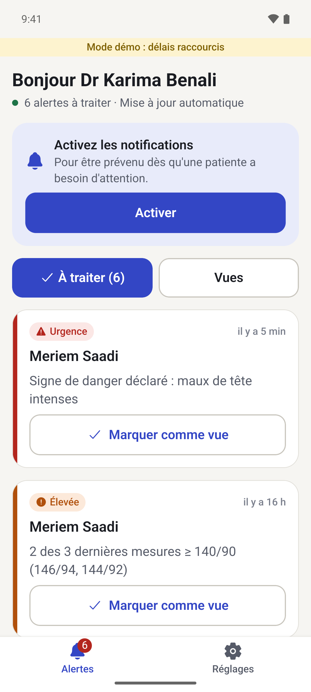 |
| Open alerts, most urgent first, "mark as seen" |

## Run it

```bash
# from the repo root
pnpm install
cp apps/mobile/.env.example apps/mobile/.env   # then fill it, see "Running against the API" below
pnpm --filter web dev      # the API, port 3000
pnpm dev:mobile            # then scan the QR code with Expo Go
```

Seeded demo accounts (password `Demo1234!`, spec §12): patients `amina@demo.dz` (stable, live demo), `nour@demo.dz`,
`meriem@demo.dz`, `khadija@demo.dz` (link pending); doctors `docteur@demo.dz`, `dr.haddad@demo.dz`. In demo mode the
login screen fills Amina or the demo doctor in one tap.

- Demo scenario: measure **165/112** → re-measure countdown (10 s in demo mode, from the API) → measure **≥ 160/110**
  again → emergency screen. Questionnaire with any danger sign → emergency screen.

## Checks

```bash
pnpm --filter mobile typecheck
pnpm --filter mobile lint
pnpm --filter mobile test     # Vitest: profile form date helpers
```

## Structure

```
src/app/              Expo Router routes
  (auth)/             welcome, login, register
  (onboarding)/       consent, profile (shown until the profile exists)
  (patient)/          tabs (home, history, chat, more) + measure, questionnaire, result, risk, doctor, reminders, assistant
  (doctor)/           alerts, settings
src/api/              http.ts (Next.js API, spec §8, answers checked with the "shared" Zod schemas), queries.ts, errors.ts
src/auth/             Supabase client + session (Supabase Auth, then GET /api/me), guards in src/app/_layout.tsx (Stack.Protected)
src/features/chat/    chat on the Supabase "Message" table + Realtime (docs/MOBILE-GUIDE.md)
src/notifications/    local reminders, re-measure alarm, doctor alert notifier
src/components/ui/    design system (Button, Card, Stepper, StatusBadge, YesNo…)
src/i18n/fr.ts        every user-facing string
src/theme/            colours, type scale, status tones
```

Rules kept: no medical rule is computed by the app — risk, levels and alerts come from the API; types, item lists,
thresholds for the chart lines and invite-code format come from `shared`. Status = icon + colour + word. Touch targets ≥ 48 px.
One safety net on the phone: if the questionnaire has a danger sign and the API is unreachable, the API's own emergency
screen (`patientEvaluation` from `shared`, level EMERGENCY) is shown anyway.

## Running against the API

1. `apps/web/.env` from Ramy, then once: `cd apps/web && npx prisma generate`. Start the API: `pnpm --filter web dev`.
2. `apps/mobile/.env`: `EXPO_PUBLIC_API_URL=http://<this computer's Wi-Fi IP>:3000` (macOS: `ipconfig getifaddr en0`),
   plus the Supabase URL and anon key. Update the IP when you change network.
3. `pnpm dev:mobile` from the repo root (or `npx expo start` inside `apps/mobile`, never at the root), scan the QR.

Supabase has e-mail confirmation on: a new account must open the link in its e-mail before logging in.

## Installing on a phone

- **Demo:** Expo Go (QR code). Local notifications (reminders, re-measure alarm) work there.
- **Android APK** (any Android phone): `npx eas-cli@latest build -p android --profile preview` (free Expo account; `eas init` once).
- **iPhone:** needs an Apple Developer account ($99/year) for TestFlight / App Store.
