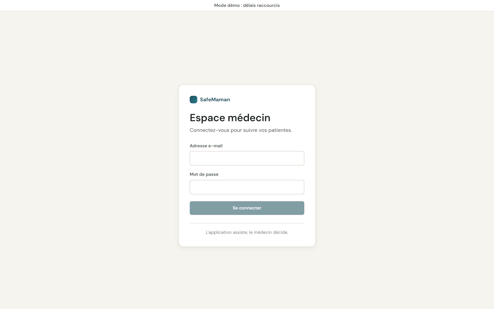
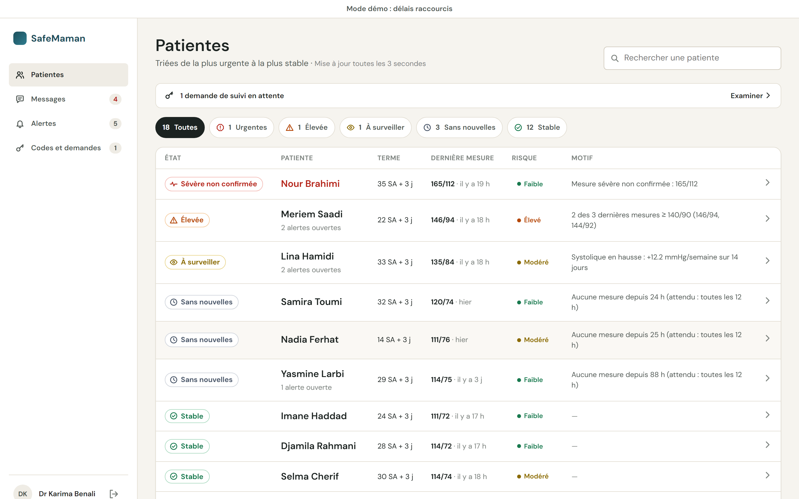
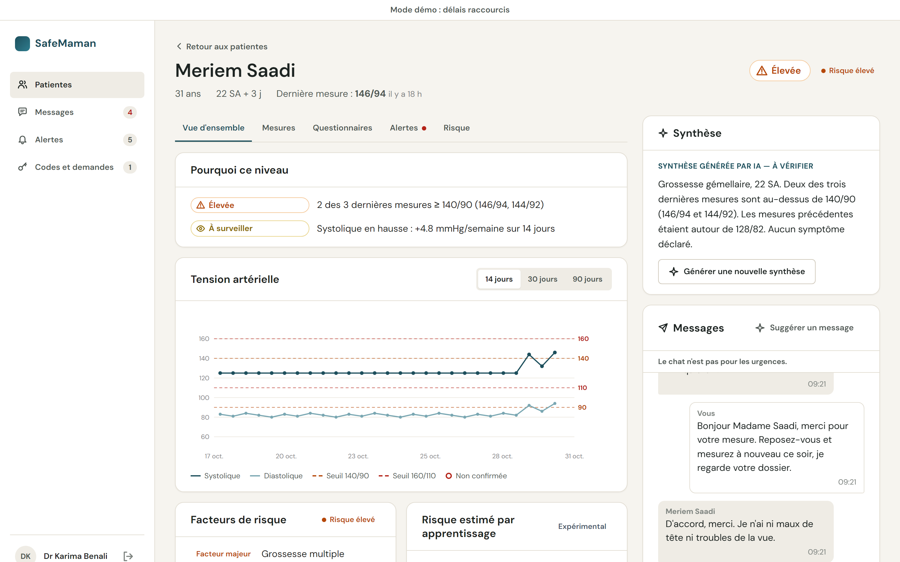
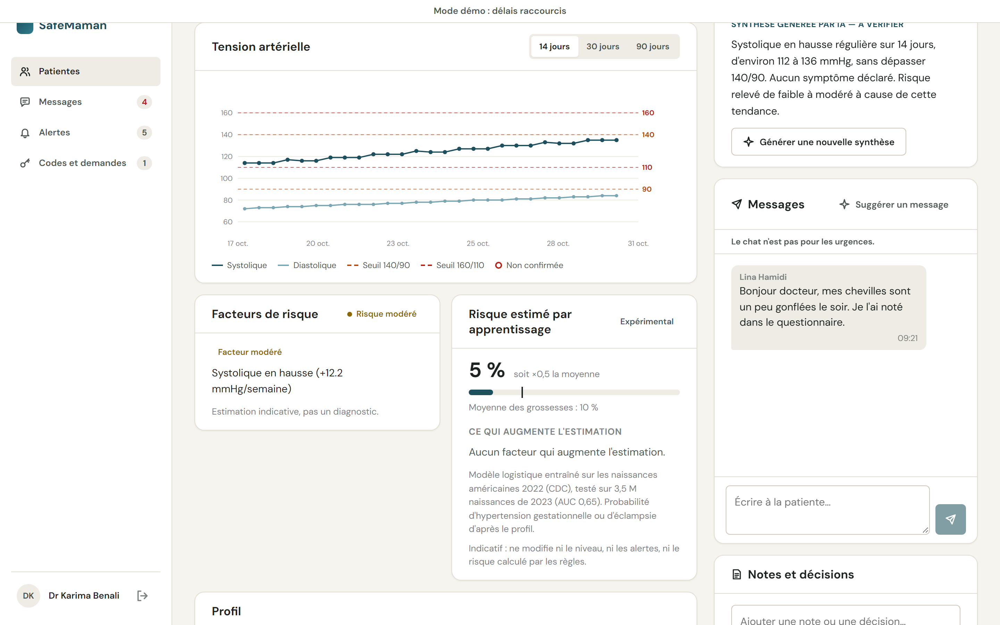
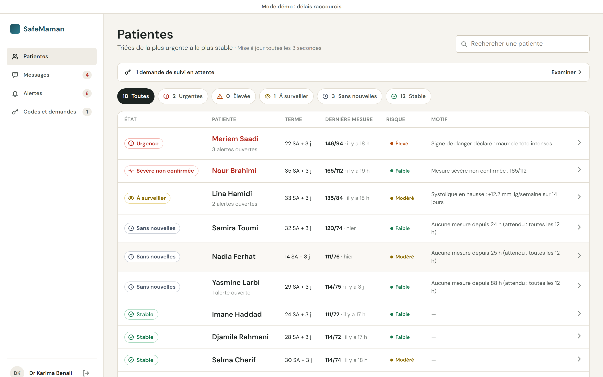
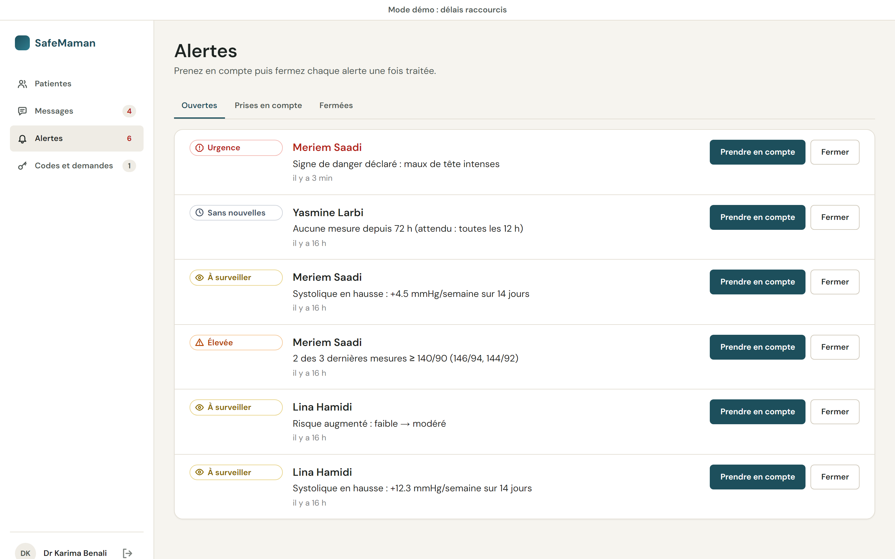
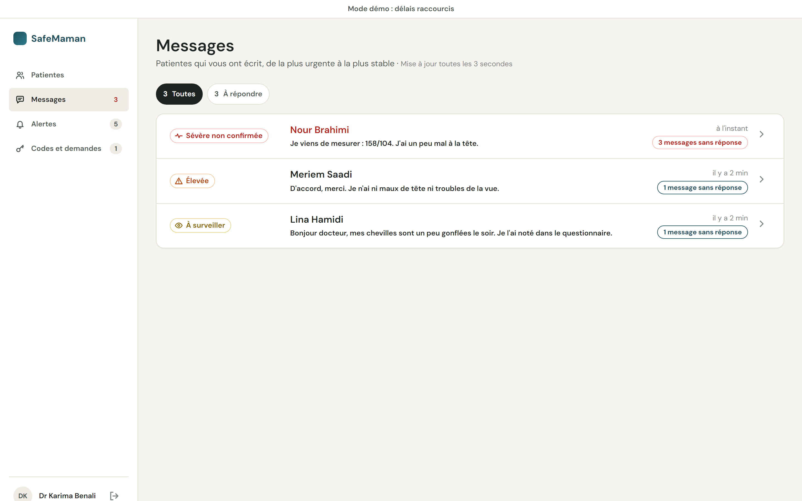
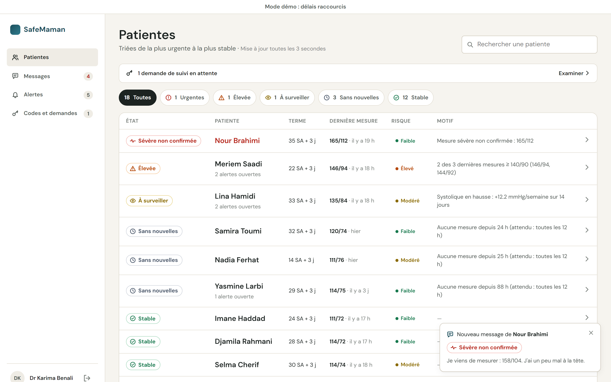
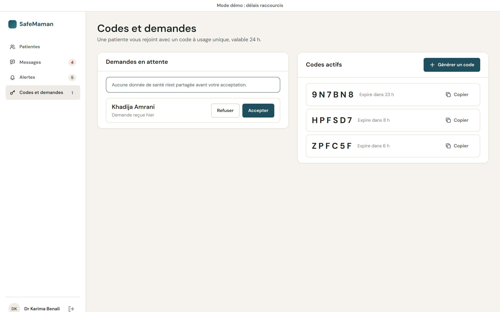

# apps/web — doctor dashboard + API

The Next.js app that serves the doctor's web dashboard and the API used by both apps.

## Screenshots

Fictional demo data, demo doctor `docteur@demo.dz`.

| | |
| --- | --- |
|  |  |
| **Login** — doctor accounts only | **Patientes** — triage list, most urgent first, filters with counts, search |
|  |  |
| **Patient file** — why this level, BP chart, AI summary, chat | **Risk** — contributing factors, learned risk (experimental), notes |
|  |  |
| A danger sign sent from the phone: the patient moves to the top | **Alertes** — open / acknowledged / closed |
|  |  |
| **Messages** — patients who wrote, most urgent first | Live card when a patient writes |
|  | |
| **Codes et demandes** — one-time codes (24 h), link requests | |

## Docs

Everything about running, testing and the API is in the [root README](../../README.md):

- [Run the web dashboard and the API](../../README.md#run-the-web-dashboard-and-the-api)
- [API reference](../../README.md#api-reference)
- [Demo accounts](../../README.md#demo-accounts)

| Folder | Content |
| --- | --- |
| `prisma/` | schema, migrations, `sql/rls.sql`, seed |
| `src/server/` | API services (auth, rules pipeline, patient, doctor, linking) |
| `src/app/api/` | API routes |
| `src/app/d/`, `src/components/` | dashboard pages and components |
| `src/lib/` | API client, queries, formatting, French dictionary (`i18n/fr.ts`) |

Scripts: `dev`, `build`, `typecheck`, `lint`, `test`, `db:deploy`, `db:migrate`, `db:rls`, `db:seed`, `db:studio`.
