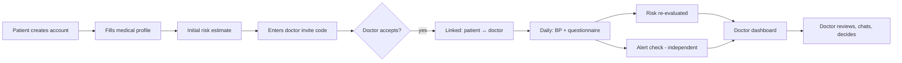
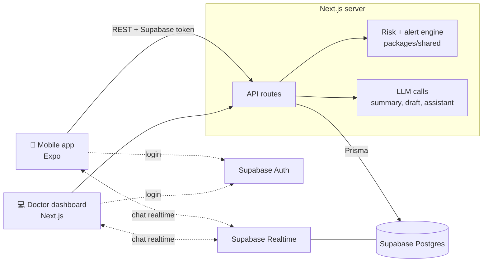

# SafeMaman — Project Idea & Roadmap

> Hackathon SolveX 3.0 · Problem 2 (Hypertension) · Focus: **pregnant women**
> Team: Rey (web dashboard + API) · Friend (mobile app)
> Status: v1 — decided on 30 Oct 2026. Items marked **[to validate]** need a doctor's confirmation.

---

## 1. The idea in one paragraph

SafeMaman helps follow **hypertension during pregnancy** between two consultations. The pregnant woman uses a **mobile app** to fill in her medical profile, record her blood pressure and answer a short symptom questionnaire. The system gives an **explainable risk estimate** (gestational hypertension / pre-eclampsia), updates it as new data comes in, and **detects worrying situations** independently. The doctor follows all his patients on a **web dashboard**, sees who needs attention first and why, chats with them, and gets an **AI summary** of each file. The doctor always decides; the app only assists.

**Pitch line:** *"Between two consultations, nothing is invisible anymore — and the doctor stays in charge."*

---

 ## 2. The problem

- Hypertension in pregnancy (gestational hypertension, pre-eclampsia) can worsen quickly and is often silent.
- Blood pressure is usually measured only at consultations, so changes between visits go unseen.
- The brief asks for **early detection, regular follow-up, and identifying situations that need medical action**, with **limited extra workload** for doctors and **measurable indicators**.
- The brief mentions *"patients présentant un risque élevé"*: pregnant women are a clear high-risk group, which is our angle.

---

## 3. Users

| User | Tool | Main goal |
| --- | --- | --- |
| 🤰 Patient (pregnant woman) | **Mobile app** (React Native / Expo) | Record BP and symptoms easily, know when to seek help, talk to her doctor |
| 👩‍⚕️ Doctor | **Web dashboard** (Next.js) | See which patients need attention, understand why, act quickly |

---

## 4. How it works (main flow)



### Linking a patient to a doctor (anti-abuse)
1. The doctor clicks **"Generate invite code"** → a **one-time code** (6 characters, valid 24 h, usable once).
2. He gives it to the patient during the consultation.
3. The patient enters it in the app → a **link request** is created.
4. The doctor **accepts or refuses** it in the dashboard.
5. Only after acceptance: data is shared and the chat opens.

A code cannot be reused or shared publicly, so nobody can attach themselves to a doctor without seeing him.

---

## 5. Patient mobile app — features

> Exact field lists will be finalised by Rey; this is the working version.

| # | Feature | Details |
| --- | --- | --- |
| 1 | **Account** | Email or phone + password (Supabase Auth) |
| 2 | **Medical profile** | Name, age, **due date or last period date** (pregnancy week computed automatically), first pregnancy?, single or multiple pregnancy, personal history: chronic hypertension, previous pre-eclampsia, diabetes, kidney disease, autoimmune disease; family history of hypertension / pre-eclampsia; height & weight (BMI); IVF pregnancy; current treatments |
| 3 | **Consent** | Clear screen explaining what data is collected and who sees it (required) |
| 4 | **Initial risk** | Shown as *Faible / Modéré / Élevé* with the factors behind it, and the sentence: "estimation indicative, pas un diagnostic" |
| 5 | **Add my doctor** | Enter invite code → "waiting for acceptance" → linked |
| 6 | **Add blood pressure** | Big +/− steppers (systolic, diastolic, pulse), date/time auto, source = manual. Guidance before measuring |
| 7 | **Daily questionnaire** | Yes/No: persistent headache, vision problems, upper abdominal pain, sudden swelling of face/hands, breathing difficulty, reduced baby movements **[to validate]** |
| 8 | **Result screen** | Status (icon + colour + word) + what to do. Danger → "Allez aux urgences de la maternité / appelez le 14 maintenant" |
| 9 | **History** | BP chart + past questionnaires |
| 10 | **Chat with doctor** | Real-time; banner: "Le chat n'est pas pour les urgences" |
| 11 | **Reminders** | Local notifications for BP and questionnaire at the times set |
| 12 | **Info assistant (AI)** | General questions about hypertension in pregnancy and how the app works. Never diagnoses, never treats |

---

## 6. Doctor web dashboard — features

| # | Feature | Details |
| --- | --- | --- |
| 1 | **Login** | Supabase Auth, role DOCTOR |
| 2 | **Invite codes** | Generate one-time codes; see pending link requests; accept / refuse |
| 3 | **Triage list (home)** | Patients sorted by urgency: status, pregnancy week, last BP, risk category, reason of the flag |
| 4 | **Alerts inbox** | Open alerts with explanation and evidence; acknowledge / close |
| 5 | **Patient file** | Profile & history, risk estimate + **factors that contributed**, risk evolution over time, BP chart with thresholds, questionnaire answers, alert history |
| 6 | **AI summary** | One-paragraph summary of the file (latest BP, trend, symptoms, alerts, risk factors), every statement checkable against the data |
| 7 | **AI draft advice** | Suggests a short message for the patient; **the doctor edits and sends it** in the chat — never automatic |
| 8 | **Observations & decisions** | Doctor notes, history of follow-up decisions |
| 9 | **Chat** | Real-time conversation with each linked patient |
| 10 | **Indicators** | Measurement frequency, BP evolution, number of alerts, follow-up regularity (the 4 indicators of the brief) + control rate, response time |

---

## 7. The intelligent part — two separate functions

Our spec separates them, and so does the code.

### 7.1 Risk prediction (future risk)
- **Initial estimate** at sign-up, from known risk factors of pre-eclampsia (guideline-based lists, e.g. previous pre-eclampsia, chronic hypertension, diabetes, kidney/autoimmune disease, multiple pregnancy, first pregnancy, age, BMI, family history, IVF) **[to validate]**.
- Output: **Faible / Modéré / Élevé** + the list of factors that produced it. Never a bare score.
- **Dynamic re-evaluation** after each new reading or questionnaire: combines the initial factors with recent BP levels, trend and symptoms. Each re-evaluation is saved, so the doctor sees how the risk evolved.
- **Explainable rules, not a trained model.** We have no validated dataset; inventing a model would be dishonest. Rules from guidelines are transparent and checkable.

### 7.2 Detection of a worrying situation (now)
Works **independently of the predicted risk**: a "low risk" patient can still trigger an alert.

| Level | Trigger **[to validate]** | Patient sees | Doctor gets |
| --- | --- | --- | --- |
| 🔴 Emergency | Any danger symptom (severe headache, vision problems, upper abdominal pain, sudden swelling, breathing difficulty, reduced baby movements) | "Go to the maternity emergency / call 14 now" | Immediate alert |
| 🔴 Severe | BP ≥ 160/110, confirmed by a second measurement 15 min later | "Go to the maternity emergency now" | Immediate alert |
| 🟠 High | BP ≥ 140/90 on 2 of the last 3 sessions | "Your doctor has been informed" + advice | Top of the list |
| 🟡 Watch | Rising trend, risk category went up, or mild symptoms | Encouragement / advice | In the list |
| ⚪ Silent | No measurement for 2× the expected interval | Reminder | Grey tag |
| 🟢 OK | Within normal range | "Bon" | Nothing |

- A danger symptom **skips everything**: no re-measure, immediate instruction.
- A single unconfirmed severe reading is shown to the doctor as *"non confirmée"* even if the patient never re-measures.
- The patient is never told to wait for an answer in the app when something is serious.

### 7.3 Where the LLM is used (and where it is not)

| ✅ LLM does | ❌ LLM never does |
| --- | --- |
| Doctor summary of a patient file | Predict blood pressure or decide risk |
| Draft advice the doctor edits and sends | Send anything to the patient by itself |
| Patient info assistant (general information) | Diagnose, interpret an emergency, recommend a treatment |

All LLM calls go through our server, with a timeout and a static fallback. The demo uses pre-generated outputs so nothing fails live.

---

## 8. Tech stack

| Part | Technology | Owner |
| --- | --- | --- |
| Repo | **One GitHub monorepo**, pnpm workspaces | Both |
| Web dashboard | **Next.js (App Router) + TypeScript + Tailwind + TanStack Query + Recharts** | Rey |
| API (backend) | **Next.js API routes** in the web app — used by both the dashboard and the mobile app | Rey |
| Mobile app | **React Native + Expo (Expo Router) + TypeScript + TanStack Query** | Friend |
| Database | **Supabase Postgres** + **Prisma** | Rey |
| Auth | **Supabase Auth** (both apps); API verifies the Supabase token | Both |
| Chat | **Supabase Realtime** on the `messages` table, protected by row-level security | Both |
| Shared code | `packages/shared`: Zod schemas, types, risk rules, alert rules, tests (Vitest) | Rey (+ Friend reads) |
| Reminders | Expo local notifications | Friend |
| AI | LLM API called only from the Next.js server | Rey |
| Deploy | Vercel (web + API), Supabase (DB/Auth/Realtime), Expo Go for the demo phone | Both |

### Architecture



**Key rule:** readings, profile and questionnaires always go **through the API**, so risk and alerts are computed in **one place**. Only the chat talks to Supabase directly.

### Repo structure

```
safemaman/
├── apps/
│   ├── web/            # Next.js dashboard + API + Prisma (Rey)
│   └── mobile/         # Expo app (Friend)
├── packages/
│   └── shared/         # Zod schemas, types, risk & alert rules, tests
├── idea.md             # this file
└── pnpm-workspace.yaml
```

---

## 9. Expected result (what we show the jury)

A working prototype with a **complete loop**:

1. A pregnant patient creates her account and profile → sees her **initial risk with its reasons**.
2. She enters her doctor's invite code → the doctor **accepts** her on the dashboard.
3. She records a blood pressure and answers the questionnaire on her phone.
4. The doctor's dashboard updates: **status, risk evolution, alert with explanation**.
5. The doctor opens the file, reads the **AI summary**, sends advice in the **chat**.
6. Live emergency moment: the patient ticks "vision problems" → she immediately sees "Go to the maternity emergency now" and the doctor gets a **red alert** within seconds.
7. We finish on the **indicators** page.

### Demo patients (fictional)
| Patient | Story | Shows |
| --- | --- | --- |
| Amina, 29, 31 weeks, first pregnancy | Normal history; live demo patient | Live alert flow |
| Sarah, 36, 26 weeks | Previous pre-eclampsia + chronic hypertension | High initial risk with factors |
| Lina, 24, 33 weeks | BP rising over 2 weeks | Re-evaluation: risk going up |
| Meriem, 31, 22 weeks, twins | Two readings ≥ 140/90 | Orange alert |
| Yasmine, 27, 29 weeks | No reading for 6 days | Silent tag |
| ~10 others | Stable | Green |

---

## 10. Timeline (30 hours, 2 people)

| Hours | Rey (web + API) | Friend (mobile) |
| --- | --- | --- |
| **H0–H1** | Together: agree on API contract + data model + screens list | same |
| **H1–H3** | Monorepo, Supabase project, Prisma schema, deploy skeleton to Vercel | Expo app skeleton, Supabase Auth login, navigation |
| **H3–H8** | Shared risk + alert rules with tests; API: profile, readings, questionnaire, invite/link | Profile form, add BP screen, questionnaire screen (with mock API) |
| **H8 checkpoint** | Mobile → API connected end to end | |
| **H8–H14** | Dashboard: triage list, patient file, alerts, accept requests | Result screen, history, enter invite code, reminders |
| **H14–H18** | Chat (Realtime + RLS), AI summary + draft (pre-generated fallback) | Chat screen, info assistant screen |
| **H18–H22** | Indicators page, seed demo data | Polish, error states, emergency screen |
| **H22–H26** | Test full loop together, fix bugs | same |
| **H26–H30** | Slides, rehearse demo, **record backup video** | same |

**Rule:** if behind schedule at H14, drop in this order: info assistant → AI draft advice → indicators charts (keep numbers) → reminders.

---

## 11. Out of scope (roadmap — we say it, we don't build it)

- Connected blood pressure monitor import (field `source` is ready for it)
- SMS channel for patients without smartphone
- Arabic interface (RTL)
- Trained machine-learning model (needs a real validated dataset)
- Push notifications from the server
- Multi-doctor teams, hospital integration

---

## 12. Privacy & safety

- Medical data is sensitive: access limited to the patient and her accepted doctor.
- Row-level security on chat messages; every API query scoped to the logged-in user.
- Consent screen at sign-up.
- Fictional data only for the demo.
- Not a diagnostic tool; thresholds and messages must be validated by a health professional.
- A low risk estimate never prevents a patient from seeking medical advice.

---

## 13. Open questions

1. Final list of profile fields and questionnaire items (Rey to confirm).
2. Thresholds and danger symptoms — validation by a doctor or midwife.
3. Expected frequency of BP measurement and questionnaire (default: BP twice a day, questionnaire once a day **[to validate]**).
4. Which LLM provider and API key we use.
